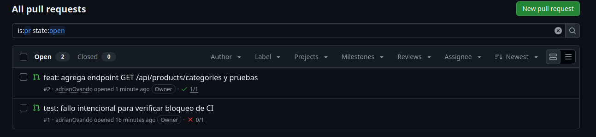
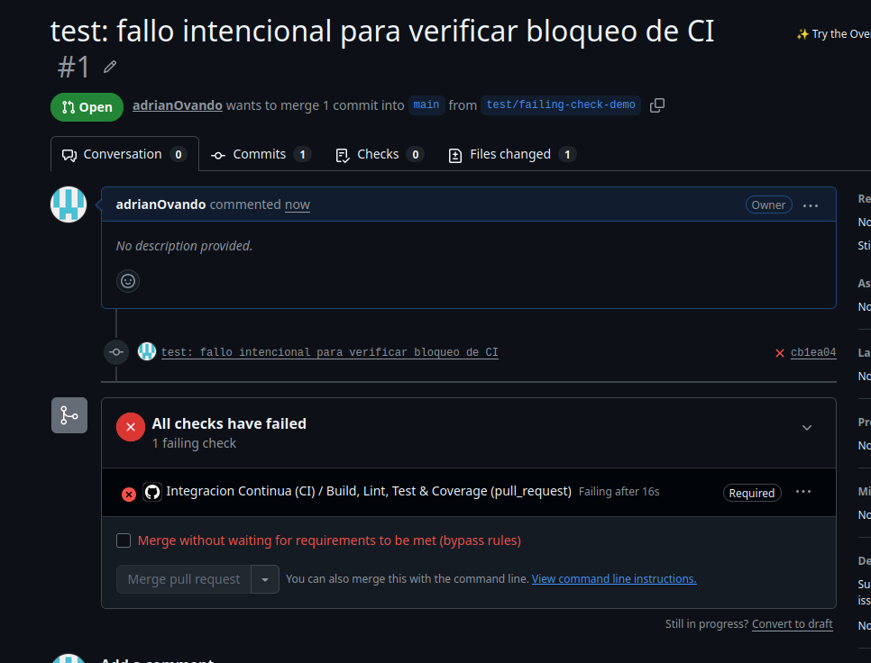
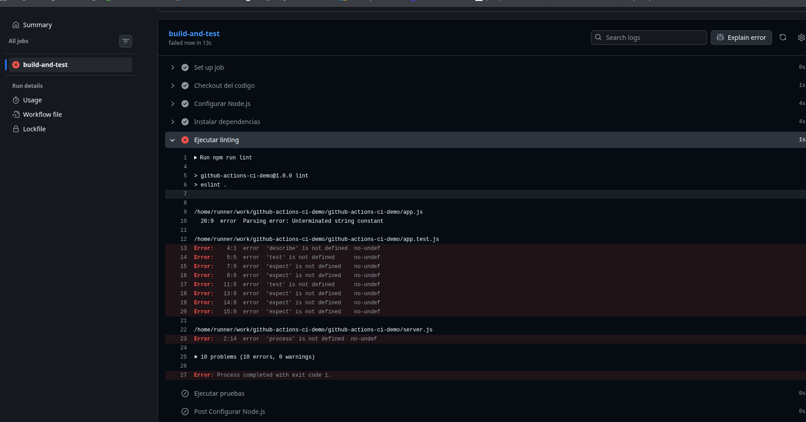
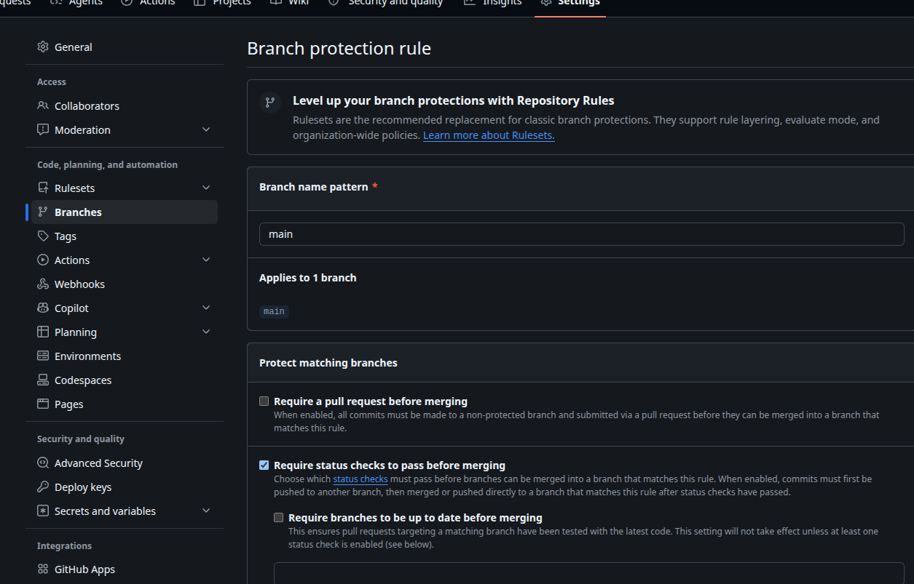
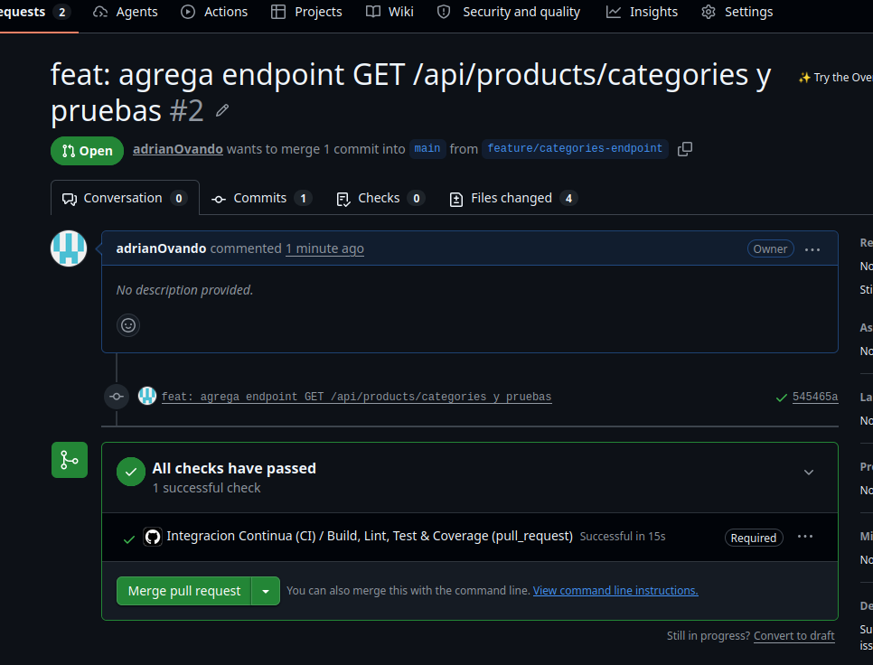

# Informe de Laboratorio 5.1 - Práctica Individual
## Implementación de Integración Continua (CI) con GitHub Actions

**Estudiante:** Jesús Adrián Ovando  
**Materia:** COM-610 - Ingeniería de Software  
**Fecha:** Noviembre 2026  
**Repositorio GitHub:** [https://github.com/adrianOvando/Lab5.1_Ejercicio4](https://github.com/adrianOvando/Lab5.1_Ejercicio4)

---

## 1. Descripción del Proyecto

Para esta práctica individual se desarrolló una API RESTful profesional utilizando **Node.js** y **Express**, enfocada en la gestión de una entidad de dominio: **`Product` (Producto)**.

### Características Principales:
- **Entidad `Product`**: Contiene atributos como `id`, `name`, `description`, `price`, `stock`, `category` y `createdAt`.
- **Operaciones CRUD Completas**:
  - `GET /api/products`: Listado general con soporte de filtrado por categoría y búsqueda textual.
  - `GET /api/products/:id`: Búsqueda individual con validación de tipos y manejo de 404.
  - `POST /api/products`: Creación de producto con validaciones de campos obligatorios (nombre, precio positivo, stock no negativo).
  - `PUT /api/products/:id`: Actualización parcial o total con validaciones de negocio.
  - `DELETE /api/products/:id`: Eliminación física controlada.
- **Endpoint de Diagnóstico**: `GET /health` que provee el uptime y estado operativo del servicio.
- **Pruebas Automatizadas**: 22 casos de prueba unitarios y de integración desarrollados con **Jest** y **Supertest**, alcanzando un **100% de cobertura en líneas y funciones**.

---

## 2. Descripción del Pipeline de CI Configurado

El flujo de trabajo se implementó en `.github/workflows/ci.yml`. Se ejecuta automáticamente ante cada evento `push` y `pull_request` dirigidos a la rama principal `main`.

### Etapas del Pipeline:
1. **Checkout del Código (`actions/checkout@v4`)**: Descarga el código fuente del repositorio en el runner `ubuntu-latest`.
2. **Setup de Node.js (`actions/setup-node@v4`)**: Configura la versión LTS de Node.js (v20) y habilita la caché de dependencias de `npm` para acelerar ejecuciones posteriores.
3. **Instalación de Dependencias (`npm ci`)**: Realiza una instalación limpia, rápida y determinista basada estrictamente en `package-lock.json`.
4. **Paso de Build / Verificación de Integridad**: Ejecuta una comprobación de arranque y sintaxis del entorno Node.js.
5. **Análisis Estático de Código (`npm run lint`)**: Ejecuta **ESLint 9** con configuración adaptada para Node.js y Jest, garantizando buenas prácticas, detección de variables sin usar y consistencia sintáctica.
6. **Ejecución de Pruebas y Cobertura (`npm run test:coverage`)**: Ejecuta Jest generando reportes en consola (`text`), en formato `lcov` y en HTML dentro del directorio `coverage/`.
7. **Publicación del Artefacto de Cobertura (`actions/upload-artifact@v4`)**: Sube los reportes generados a GitHub Actions para su descarga y auditoría posterior con retención de 14 días.

---

## 3. Configuración de Reglas de Protección de Rama (`Branch Protection Rules`)

Para garantizar que ningún código defectuoso llegue a producción o a la rama principal, se configuró una regla de protección en GitHub para la rama `main`:

### Pasos aplicados en GitHub:
1. En el repositorio, navegar a **Settings** $\rightarrow$ **Branches** $\rightarrow$ **Add branch protection rule** (o **Add classic branch protection rule**).
2. En **Branch name pattern**, escribir: `main`.
3. Activar la opción **Require status checks to pass before merging**.
4. En la barra de búsqueda de checks, seleccionar el job obligatorio del workflow: **`Build, Lint, Test & Coverage`**.
5. (Opcional) Activar **Require branches to be up to date before merging**.
6. Guardar los cambios con **Save changes**.

---

## 4. Evidencias y Capturas de Pantalla

A continuación se presentan las evidencias del funcionamiento del pipeline y los controles de calidad implementados:

### 4.1 Historial de Ejecuciones en la Pestaña Actions
Muestra el registro de ejecuciones automáticas disparadas por commits y Pull Requests.

*Figura 1: Historial de workflows ejecutados en GitHub Actions.*

---

### 4.2 Detalle de Workflow Exitoso con Cobertura
Demuestra la ejecución de todos los pasos en verde (Checkout, Setup Node, npm ci, Lint, Test & Coverage y Upload Artifact), alcanzando 100% de cobertura.

*Figura 2: Detalle de ejecución exitosa con reporte de cobertura de pruebas.*

---

### 4.3 Detalle de Workflow Fallido
Demuestra que el pipeline detecta fallos oportunamente (ejemplo: un error de linting forzado o una prueba que no pasa), bloqueando la integración.

*Figura 3: Detalle de pipeline interrumpido al fallar el análisis estático o las pruebas.*

---

### 4.4 Configuración de la Regla de Protección de Rama
Muestra la configuración en GitHub Settings donde se exige que el check `Build, Lint, Test & Coverage` pase satisfactoriamente antes de autorizar el merge hacia `main`.

*Figura 4: Regla de protección activa para la rama main.*

---

### 4.5 Pull Request y Bloqueo / Desbloqueo de Merge
Muestra una Pull Request creada desde una rama secundaria (`feature/`) hacia `main`, donde GitHub bloquea el botón de Merge mientras el pipeline se ejecuta o si falla, y lo habilita una vez aprobado.

*Figura 5: Pull Request bloqueada hasta que el workflow de CI finaliza exitosamente.*

---

## 5. Conclusiones y Reflexión

1. **Detección temprana de errores**: La Integración Continua (CI) evita que código con errores de sintaxis, violaciones de estándares o fallas lógicas llegue a la rama principal. Al ejecutar el linter y la suite de pruebas en cada commit, el tiempo de respuesta frente a un bug se reduce drásticamente.
2. **Garantía de Cobertura y Calidad**: La inclusión del reporte automatizado de cobertura (`jest --coverage`) permite al equipo de desarrollo visualizar de forma objetiva qué partes del código han sido validadas, asegurando que las nuevas funcionalidades vengan acompañadas de sus respectivas pruebas.
3. **Seguridad en el Trabajo Colaborativo**: Combinar GitHub Actions con **Branch Protection Rules** elimina la dependencia de la disciplina manual. El sistema actúa como un guardián automatizado que bloquea fusiones accidentales o apresuradas, permitiendo que las revisiones de código (Code Reviews) se enfoquen en la arquitectura y valor de negocio en lugar de verificar detalles sintácticos o pruebas rotas.
4. **Reproducibilidad y Consistencia**: Al ejecutar el pipeline en entornos aislados (`ubuntu-latest`), se elimina el clásico problema de *"en mi máquina sí funciona"*, garantizando que la aplicación funciona correctamente bajo instalaciones limpias y configuraciones controladas.
